# Guia de funções

**Português** · [English](GUIDE.md) · [voltar ao README](../README.md)

O que o Grimório de Venetia faz, tela por tela, com exemplos. As imagens usam uma campanha de
demonstração (*A Coroa de Vel’Kar*). O roteiro para refazê-las está em
[`scripts/README.md`](../scripts/README.md#capturas-da-documentação).

- [1. Personagens](#1-personagens)
  - [Criar um personagem](#criar-um-personagem) · [Ficha de jogo](#ficha-de-jogo) · [PDF e backup](#pdf-e-backup)
- [2. Área do Mestre](#2-área-do-mestre)
  - [Campanhas](#campanhas) · [Players](#players) · [NPCs e gerador](#npcs-e-gerador) · [Bestiário](#bestiário)
  - [Encontros e combate](#encontros-e-combate) · [Visão da mesa](#visão-da-mesa) · [Mapas de grade](#mapas-de-grade) · [Mapas de área](#mapas-de-área-beta) · [Notas](#notas)
- [3. Salas online](#3-salas-online)
  - [Abrir a sala](#abrir-a-sala-mestre) · [Entrar](#entrar-na-sala-player) · [Fichas ao vivo](#fichas-ao-vivo) · [Transmitir o encontro](#transmitir-o-encontro)
  - [Rolagens e chat](#rolagens-e-chat) · [Rolar pela ficha](#rolar-pela-ficha) · [Notas compartilhadas](#notas-compartilhadas) · [O que cada um vê](#o-que-cada-um-vê)

---

## 1. Personagens

### Criar um personagem

**Início → Criar Personagem** abre o assistente de 13 passos: nível, classe, subclasse, espécie,
atributos, antecedente, multiclasse, perícias, magias, idiomas, equipamento, personalidade e
revisão. Cada passo aplica as regras de 2024; não dá para avançar com escolha inválida.

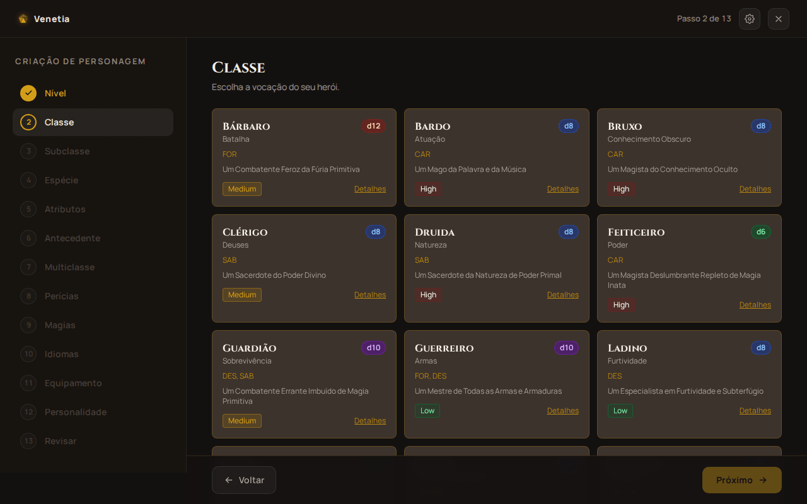

**Atributos, três jeitos:**

| Método | Como funciona | Exemplo |
|---|---|---|
| Conjunto padrão | distribui `15, 14, 13, 12, 10, 8` | guerreiro: FOR 15, CON 14, DES 13… |
| Rolagem | 4d6 descartando o menor, seis vezes; você escolhe onde cada resultado vai | `6 5 3 1` → 14 |
| Compra de pontos | 27 pontos; 8 custa 0, 15 custa 9 | 15, 15, 15, 8, 8, 8 gasta os 27 |

O antecedente dá **+2/+1 (ou +1/+1/+1)** e um **talento de origem**. A multiclasse confere os
pré-requisitos (por exemplo, FOR ou DES 13 para guerreiro). O personagem é salvo enquanto você
avança: dá para fechar o app no meio e continuar depois.

### Ficha de jogo

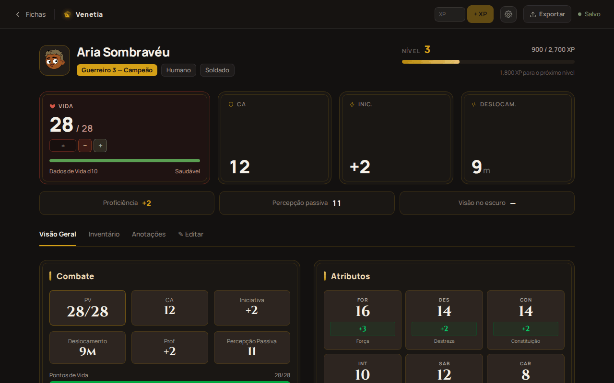

| Para… | Faça | Exemplo |
|---|---|---|
| tomar dano ou curar | digite no campo **±** e toque **Aplicar** | `-7` tira 7 PV; `5` cura 5 (até o máximo) |
| PV temporários | campo **PV Temporário** | `8` — o valor novo substitui o anterior (temporários não se somam) |
| Dados de Vida | **Gastar dado** marca um dado usado | role o d10 e cure com o campo **±** |
| descansar | **Desc. Curto** / **Desc. Longo** | o curto devolve os espaços de Pacto (bruxo); o longo devolve PV, espaços de magia e recursos de classe |
| subir de nível | **+ XP** ou **⬆ Subir de Nível** | no 4, escolha +2 num atributo, +1/+1 ou um talento geral |
| gastar magia | aba de magias, nos espaços do círculo | espaços de Pacto (bruxo) voltam no descanso curto |
| controlar carga | aba **Inventário** | peso total e moedas; itens mágicos com cargas |

Tudo o que o assistente preenche continua editável na aba **✎ Editar** (identidade, atributos,
perícias, ataques, magias, proficiências…).

### PDF e backup

- **Exportar → PDF preenchido**: a ficha oficial completa (PT ou EN, conforme o idioma), pronta
  para arquivar.
- **Exportar → PDF para imprimir**: deixa em branco o que muda na mesa (PV atual, XP, espaços
  gastos), para preencher a lápis.
- **Exportar → Backup (JSON)** e **Início → Importar JSON**: levam o personagem para outro
  aparelho. O mestre também importa esse JSON na campanha.

---

## 2. Área do Mestre

### Campanhas

**Início → Área do Mestre.** Cada campanha guarda players, NPCs, encontros, mapas e notas no
aparelho do mestre. O cartão mostra os números e o combate em andamento.

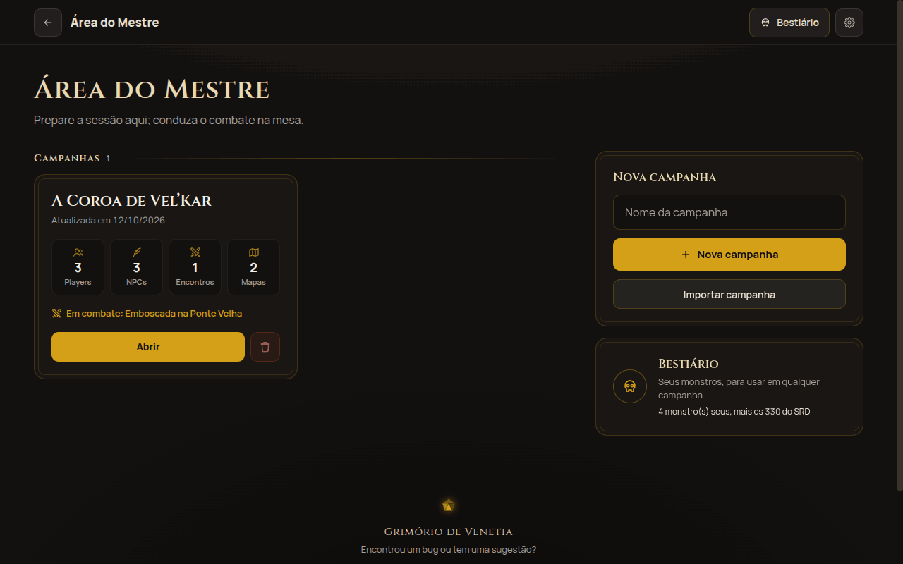

**Exportar** (dentro da campanha) gera um JSON com tudo, inclusive os mapas de área; **Importar
campanha** cria uma cópia em outro aparelho.

### Players

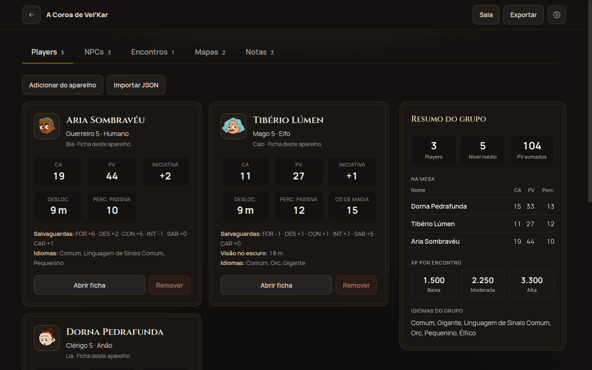

Três jeitos de pôr um player na mesa:

1. **Adicionar do aparelho**: a ficha que está neste mesmo aparelho, atualizada sempre que a
   campanha abre.
2. **Importar JSON**: o backup que o player manda; **Reimportar** troca pela versão nova.
3. **Pela sala online**: a ficha chega sozinha e atualiza ao vivo (veja
   [Fichas ao vivo](#fichas-ao-vivo)).

O **Resumo do grupo** mostra CA, PV e Percepção passiva de todos, o orçamento de XP por encontro
(regra de 2024: baixa, moderada, alta) e os idiomas do grupo.

### NPCs e gerador

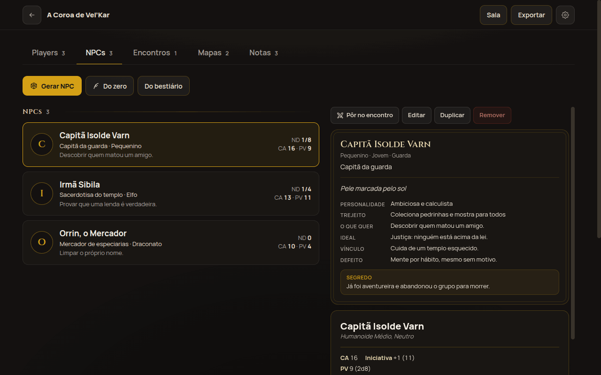

Cada NPC tem perfil (aparência, personalidade, ideal, vínculo, defeito, o que quer e um segredo)
e bloco de estatísticas. Ele é uma **cópia**: editar o NPC não mexe no bestiário.

**Gerar NPC** monta um NPC pronto em um toque:

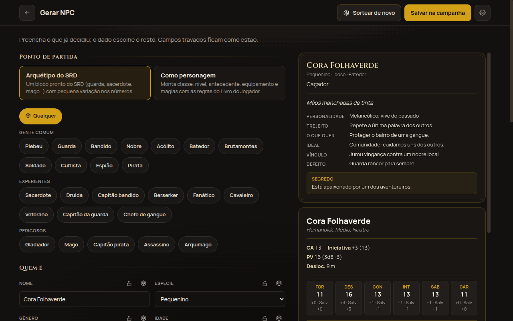

- **Arquétipo do SRD**: guarda, sacerdote, bandido, mago… com o bloco do SRD e pequena variação
  nos números.
- **Como personagem**: classe, nível, antecedente, equipamento e magias montados com as regras do
  Livro do Jogador; o bloco sai com ataques, Ataque Extra e conjuração resumida.
- Preencha o que já decidiu (por exemplo, nome *Capitã Isolde Varn*, gênero, ocupação *Capitã da
  guarda*); o cadeado trava o campo, e **Sortear de novo** troca só o resto.

### Bestiário

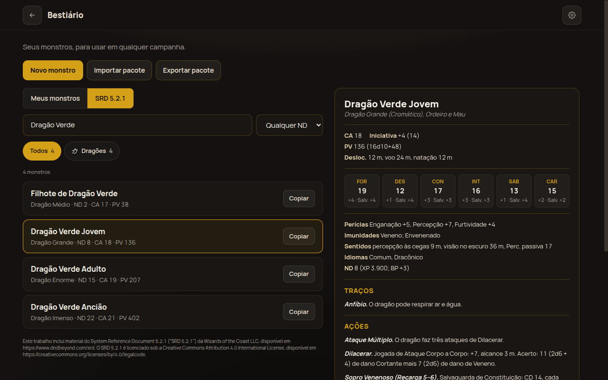

- **SRD 5.2.1**: 330 monstros (PT e EN), agrupados por tipo, com busca e filtro de ND. **Copiar**
  leva o monstro para os seus, editável.
- **Meus monstros**: os do seu livro, cadastrados no editor (2024: CA, PV, deslocamentos em
  metros, salvaguardas, ações, ações lendárias…).
- **Pacote de monstros**: exporte e importe um JSON para dividir com outro mestre. Monstros com o
  mesmo `id` são substituídos:

```json
{
  "format": "venetia-monsters",
  "version": 1,
  "monsters": [{ "id": "meu-ogro-chefe", "statblock": { "name": "Ogro Chefe", "cr": "3", "...": "..." } }]
}
```

### Encontros e combate

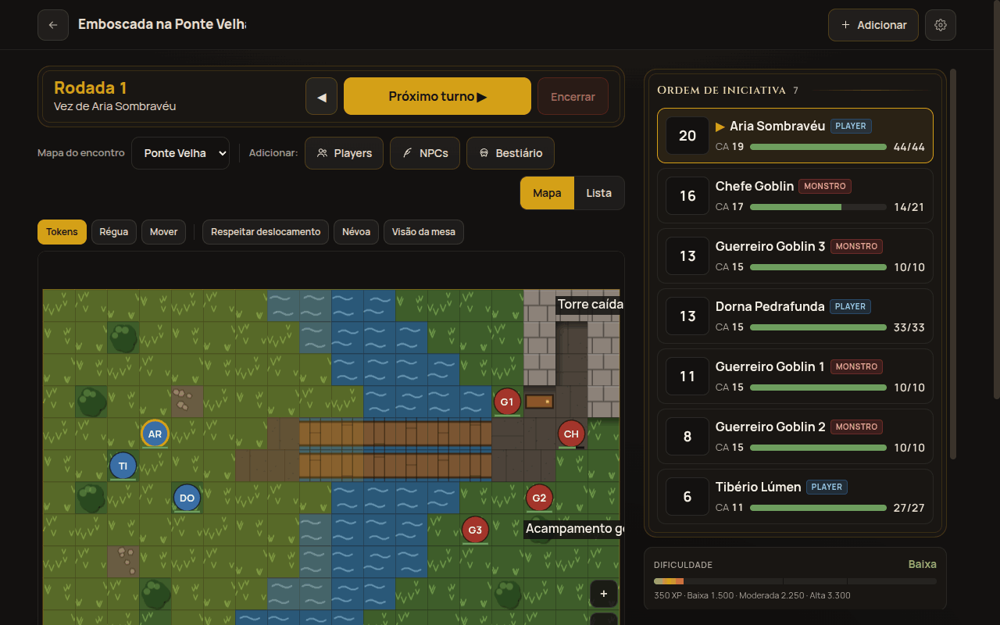

1. **Encontros → Novo encontro**; adicione **Players**, **NPCs** ou monstros do **Bestiário**
   (com quantidade: *3 Guerreiros Goblin* viram Goblin 1, 2 e 3).
2. **Rolar iniciativa** (todos, só os monstros ou só quem falta) e **Começar**.
3. **Próximo turno** avança; a lista segue a ordem e o turno atual fica marcado.

No painel do combatente:

| Ação | Exemplo |
|---|---|
| dano / cura / PV temporários | `12` de dano tira primeiro os temporários; monstro em 0 PV fica derrotado, player fica Inconsciente |
| concentração | 23 de dano num conjurador concentrado → teste de CON **CD 11** (`máx(10, metade do dano)`, até 30) |
| condições | Caído, Contido, Envenenado, Atordoado… (lista de 2024) |
| rolar uma ação do bloco | ataque e dano rolados e registrados no log; crítico dobra só os dados |

A **Dificuldade** compara o XP dos monstros com o orçamento do grupo.

**No mapa:**
- Arrastar o token de **quem tem a vez** gasta deslocamento pelo caminho real: terreno difícil
  custa 2, paredes bloqueiam, a diagonal conta como 1 casa (1,5 m).
- Arrastar outro token é reposicionamento livre do mestre.
- **Respeitar deslocamento** recusa movimentos impossíveis.
- **Névoa** esconde áreas à mão; **Régua** mede distâncias.
- Cada combatente tem modo andar, voar ou nadar.

### Visão da mesa

**Visão da mesa** vira a tela só de mapa, para mostrar aos jogadores (um tablet virado para a mesa,
por exemplo). É exatamente o que os players veem na sala online:

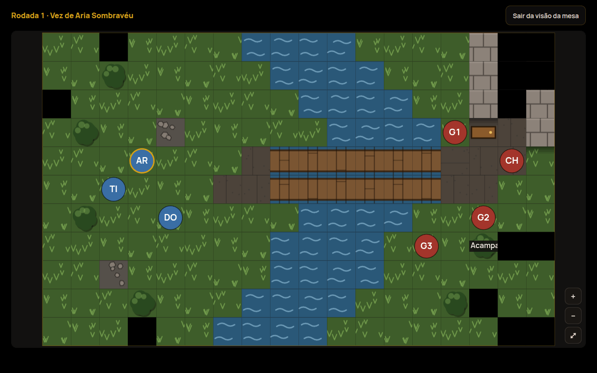

- **Em vista**: o que os tokens do grupo enxergam em linha de visão. Parede, pilar, árvore, pedra
  e vazio bloqueiam; porta não. A névoa do mestre esconde por cima.
- **Explorado**: o que o grupo já viu, esmaecido e sem criaturas. Fica guardado no mapa e vale nas
  próximas batalhas nele.
- **Nunca visto**: preto.
- **Esquecer o explorado** (ferramentas do mapa) zera a memória.

### Mapas de grade

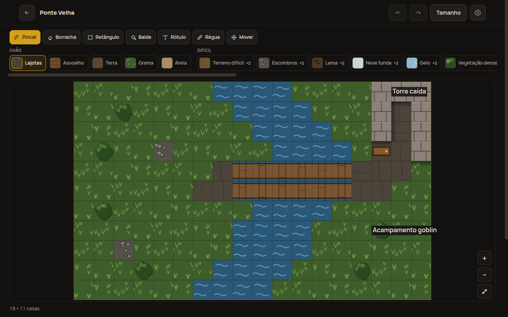

Grade de casas de 1,5 m (até 100×100). Ferramentas: **Pincel**, **Borracha**, **Retângulo**,
**Balde** (preenche a área contínua), **Rótulo**, **Régua** e **Mover**, com desfazer e refazer.
Os terrenos vêm em grupos (chão, difícil, água, construção, perigo); a textura, não a cor, é o que
diferencia cada um.

### Mapas de área (Beta)

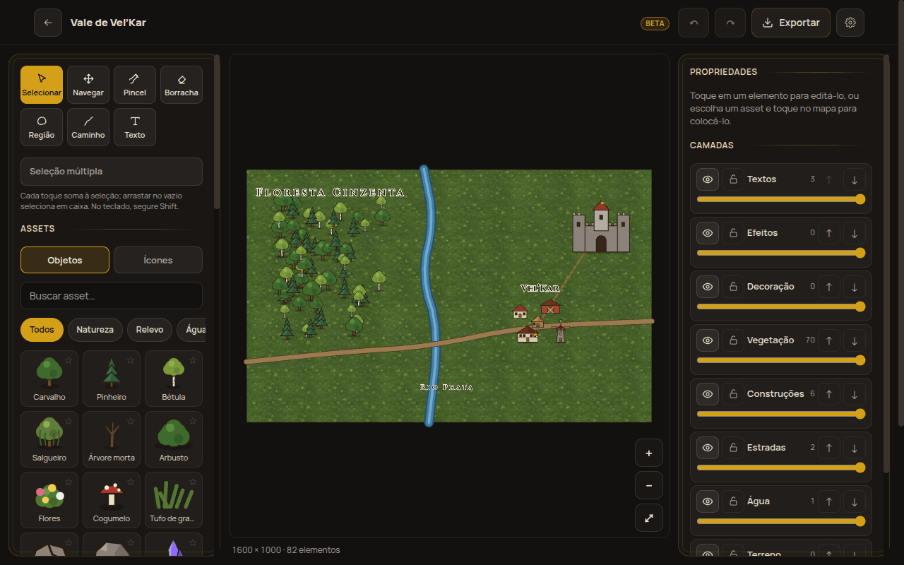

Para o mapa da região, da cidade ou do mundo, sem regra de combate:

- **Pincel** de texturas pintadas (grama, floresta, areia, neve…) com bordas que seguem a textura.
- **Objetos** (árvores, casas, castelos, ruínas…) e **ícones** (cidade, perigo, missão).
- **Caminhos**: estrada, trilha, rio, muralha, fronteira.
- **Regiões** e **textos**, em **camadas** (mostrar, travar, opacidade).
- **Exportar** em PNG ou JPEG.

### Notas

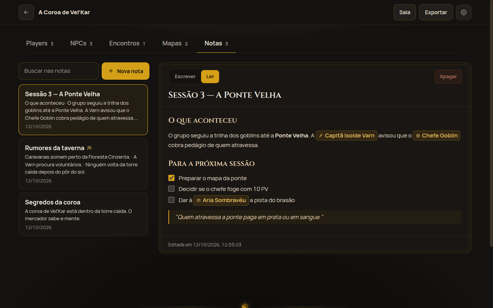

Várias notas por campanha, em **markdown**, com busca. **Escrever** edita; **Ler** mostra
formatado. Na leitura, a caixa de uma tarefa marca e desmarca de verdade.

| Você escreve | Aparece |
|---|---|
| `**negrito**`, `_itálico_`, `~~riscado~~` | **negrito**, *itálico*, ~~riscado~~ |
| `## Título` | um título de seção |
| `- item` e `1. item` | listas |
| `- [ ] preparar o mapa` | uma tarefa com caixa de marcar |
| `> "Quem atravessa paga em prata."` | uma citação |
| `\| A \| B \|` + `\|---\|---\|` | uma tabela |

**Citar com `@`:** digite `@` e o começo do nome; a barra vira sugestões de players, NPCs,
monstros do bestiário e do SRD. Escolha com as setas e **Enter** (ou toque):

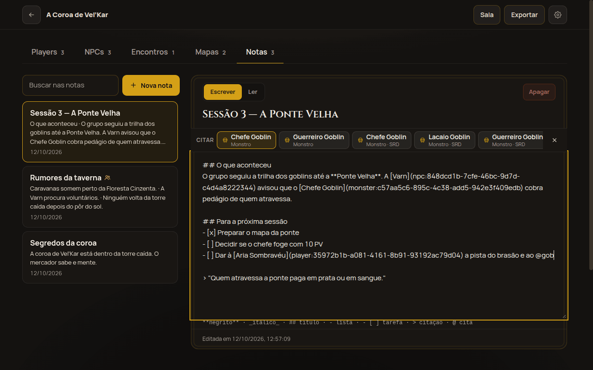

Na leitura, a citação vira um chip com o **nome atual** (renomear o NPC atualiza a nota). Tocar no
chip abre a ficha: bloco do NPC ou do monstro, ou o resumo do player. Quem foi apagado aparece
riscado.

---

## 3. Salas online

A campanha continua no aparelho do mestre; a sala só leva o que o mestre publica. Não há conta:
cada aparelho entra com um código e guarda um token. Precisa de internet.

### Abrir a sala (mestre)

1. Na campanha, toque **Sala → Abrir sala** (dê o nome da mesa e o seu).
2. Passe o **código de 6 letras** aos players (**Copiar código** ou **Compartilhar**).
3. O painel mostra quem entrou e quem está online; **Remover** tira um player, **Fechar sala**
   encerra para todos.

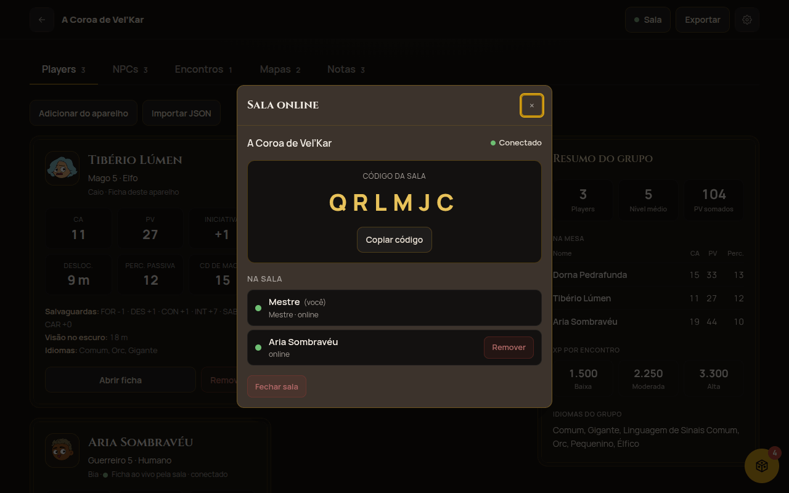

### Entrar na sala (player)

1. **Início → Entrar numa sala**.
2. Digite o código (`QRL-MJC` e `qrlmjc` também valem), escolha a ficha e o nome na mesa.
3. A sala abre com as abas **Mesa**, **Rolagens e chat**, **Notas** e **Sala online**. As salas em
   que você entrou ficam em **Suas salas**, na tela inicial.

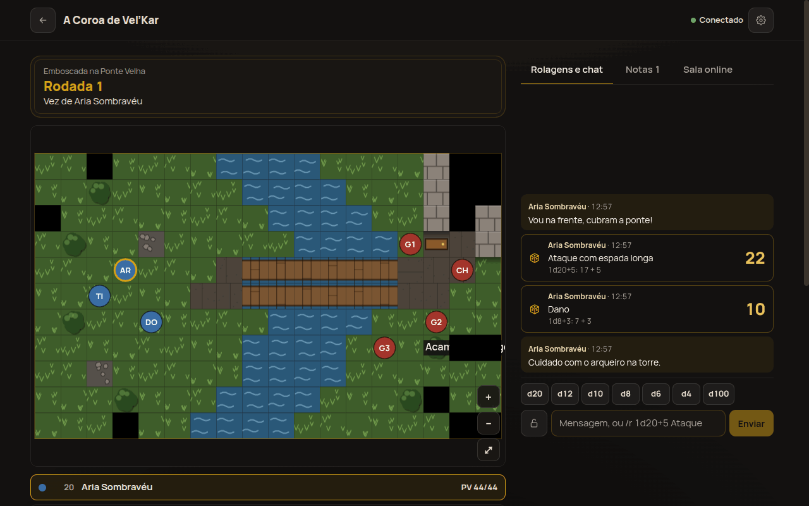

### Fichas ao vivo

A ficha de quem entrou na sala aparece em **Players** como *Ficha ao vivo pela sala ·
conectado*. Cada mudança que o player faz (PV, nível, magias…) chega ao mestre em menos de um
segundo. Se o player sair ou for removido, a ficha fica como **importada**, com a última versão.
O mestre nunca escreve na ficha do player.

### Transmitir o encontro

No encontro, toque **Transmitir para a mesa**. A partir daí, cada mudança (movimento, turno, PV,
condições) aparece na aba **Mesa** dos players, com as regras de [Visão da mesa](#visão-da-mesa).
Inimigos mostram só a faixa de vida: *Ileso, Ferido, Sangrando* (metade ou menos) ou *Fora de
combate*.

### Rolagens e chat

O dado é rolado **no servidor**: ninguém escolhe o resultado.

| Você digita / toca | Resultado |
|---|---|
| `d20`, `d12`, `d10`, `d8`, `d6`, `d4`, `d100` | rola um dado na hora |
| `/r 1d20+5 Ataque com espada` | rola `1d20+5` com o rótulo *Ataque com espada* |
| `/r 2d6+1d4+3 Dano` | vários dados e bônus numa rolagem |
| `/roll 8d6 Bola de Fogo` | `/roll` também vale |
| `Vou na frente, cubram a ponte!` | mensagem no chat |
| cadeado ligado | **player**: só o mestre vê · **mestre**: só você vê |

Limites: até 100 dados por rolagem, até d1000. Fora da página da sala, o log fica no **botão
flutuante** (com o número de novidades), em qualquer tela.

### Rolar pela ficha

Com a ficha numa sala conectada, aparecem dados ao lado de testes de atributo, salvaguardas,
perícias, iniciativa e ataques (acerto e dano). O resultado vai para o log da sala e aparece num
aviso rápido:

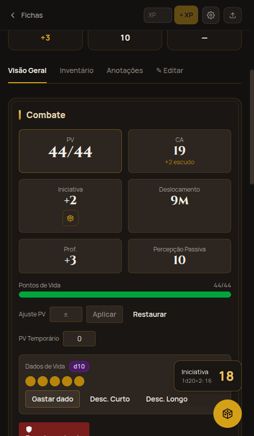

### Notas compartilhadas

Na nota, **Compartilhar com a mesa** (aparece com a sala aberta) publica a nota para os players, que
a leem na aba **Notas**. As citações a NPCs e monstros aparecem só como o nome, porque o player não
tem essas fichas. Editar atualiza na hora; descompartilhar ou apagar tira da sala.

### O que cada um vê

| | Mestre | O player autor | Os outros players |
|---|---|---|---|
| ficha de um player | ✔ | ✔ | — |
| mesa transmitida | tudo | só o visível ao grupo | só o visível ao grupo |
| rolagem pública | ✔ | ✔ | ✔ |
| rolagem privada do player | ✔ | ✔ | — |
| rolagem privada do mestre | ✔ | — | — |
| nota compartilhada | ✔ | ✔ | ✔ |
| nota não compartilhada | ✔ | — | — |

O servidor aplica essas regras antes de mandar qualquer coisa: o que um player não pode ver não
chega ao aparelho dele. Salas fechadas somem em 7 dias; salas sem uso, em 30.
