# Feature guide

[Português](GUIA.md) · **English** · [back to the README](../README.en.md)

What Venetia's Grimoire does, screen by screen, with examples. The images use a demo campaign
(*The Crown of Vel’Kar*). How to regenerate them is in
[`scripts/README.md`](../scripts/README.md#capturas-da-documentação).

- [1. Characters](#1-characters)
  - [Create a character](#create-a-character) · [Play sheet](#play-sheet) · [PDF and backup](#pdf-and-backup)
- [2. Game Master Area](#2-game-master-area)
  - [Campaigns](#campaigns) · [Players](#players) · [NPCs and generator](#npcs-and-generator) · [Bestiary](#bestiary)
  - [Encounters and combat](#encounters-and-combat) · [Table view](#table-view) · [Grid maps](#grid-maps) · [Area maps](#area-maps-beta) · [Notes](#notes)
- [3. Online rooms](#3-online-rooms)
  - [Open a room](#open-a-room-gm) · [Join](#join-a-room-player) · [Live sheets](#live-sheets) · [Broadcast the encounter](#broadcast-the-encounter)
  - [Rolls and chat](#rolls-and-chat) · [Roll from the sheet](#roll-from-the-sheet) · [Shared notes](#shared-notes) · [Who sees what](#who-sees-what)

---

## 1. Characters

### Create a character

**Home → Create Character** opens the 13-step wizard: level, class, subclass, species, abilities,
background, multiclass, skills, spells, languages, equipment, personality and review. Every step
applies the 2024 rules; you can't move on with an invalid choice.

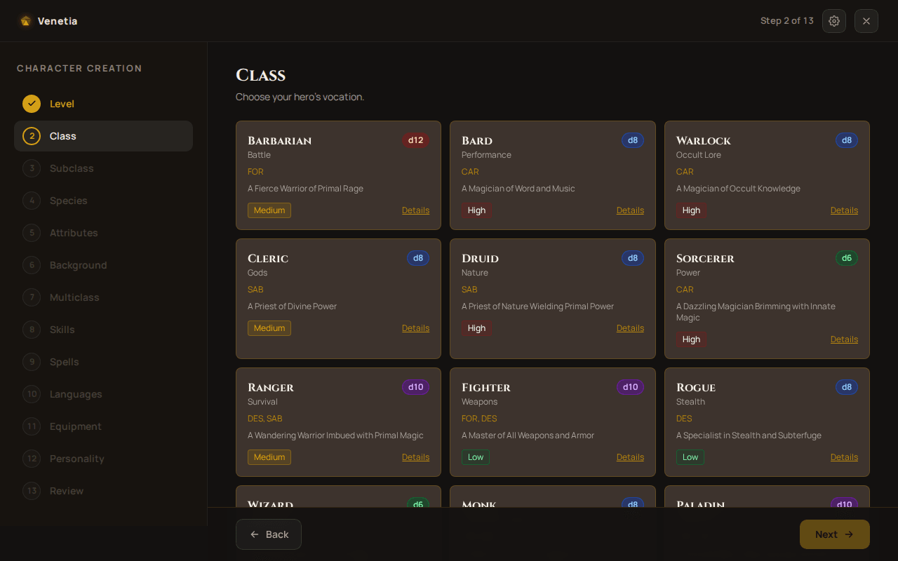

**Abilities, three ways:**

| Method | How it works | Example |
|---|---|---|
| Standard array | assign `15, 14, 13, 12, 10, 8` | fighter: STR 15, CON 14, DEX 13… |
| Roll | 4d6 drop the lowest, six times; you pick where each result goes | `6 5 3 1` → 14 |
| Point buy | 27 points; 8 costs 0, 15 costs 9 | 15, 15, 15, 8, 8, 8 spends all 27 |

The background gives **+2/+1 (or +1/+1/+1)** and an **origin feat**. Multiclassing checks the
prerequisites (for example, STR or DEX 13 for fighter). The character is saved as you go: you can
close the app halfway and continue later.

### Play sheet

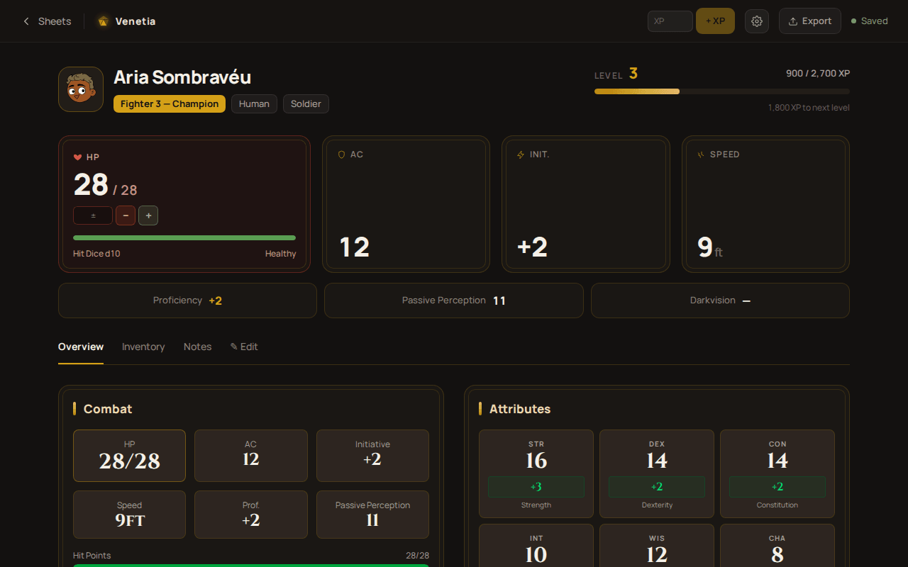

| To… | Do | Example |
|---|---|---|
| take damage or heal | type in the **±** field and tap **Apply** | `-7` removes 7 HP; `5` heals 5 (up to the maximum) |
| temporary HP | **Temporary HP** field | `8` — the new value replaces the old one (temporary HP doesn't stack) |
| Hit Dice | **Spend die** marks one die as used | roll the d10 and heal with the **±** field |
| rest | **Short Rest** / **Long Rest** | short gives back Pact slots (warlock); long gives back HP, spell slots and class resources |
| level up | **+ XP** or **⬆ Level Up** | at 4, pick +2 to one ability, +1/+1 or a general feat |
| cast | spells tab, on the circle's slots | Pact Magic slots (warlock) come back on a short rest |
| track load | **Inventory** tab | total weight and coins; magic items with charges |

Everything the wizard fills stays editable in the **✎ Edit** tab (identity, abilities, skills,
attacks, spells, proficiencies…).

### PDF and backup

- **Export → Filled PDF**: the complete official sheet (PT or EN, following the language), ready
  to archive.
- **Export → PDF to print**: leaves blank what changes at the table (current HP, XP, spent slots),
  to fill in pencil.
- **Export → Backup (JSON)** and **Home → Import JSON**: move the character to another device.
  The GM imports the same JSON into the campaign.

---

## 2. Game Master Area

### Campaigns

**Home → Game Master Area.** Each campaign keeps players, NPCs, encounters, maps and notes on the
GM's device. The card shows the counts and the running combat.

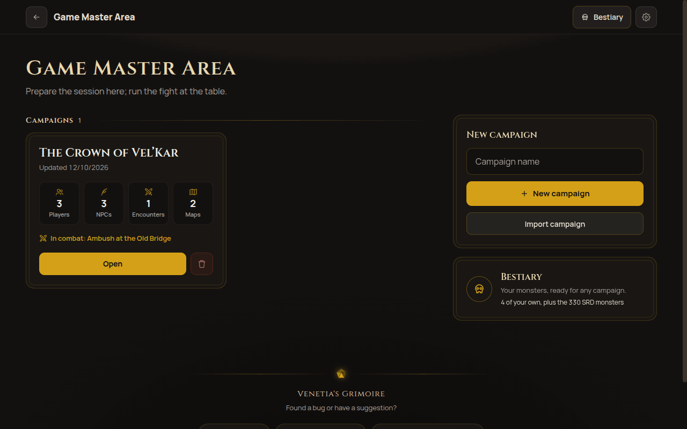

**Export** (inside the campaign) makes a JSON with everything, area maps included; **Import
campaign** creates a copy on another device.

### Players

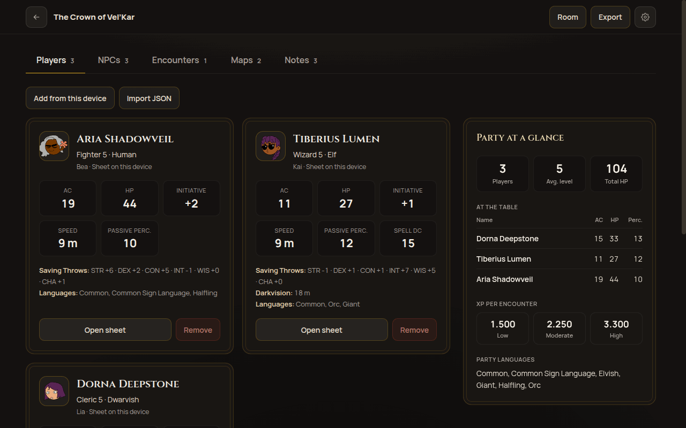

Three ways to bring a player to the table:

1. **Add from this device**: a sheet on this same device, refreshed whenever the campaign opens.
2. **Import JSON**: the backup the player sends; **Reimport** swaps in the new version.
3. **Through the online room**: the sheet arrives by itself and updates live (see
   [Live sheets](#live-sheets)).

The **Party summary** shows everyone's AC, HP and passive Perception, the XP budget per encounter
(2024 rule: low, moderate, high) and the party's languages.

### NPCs and generator

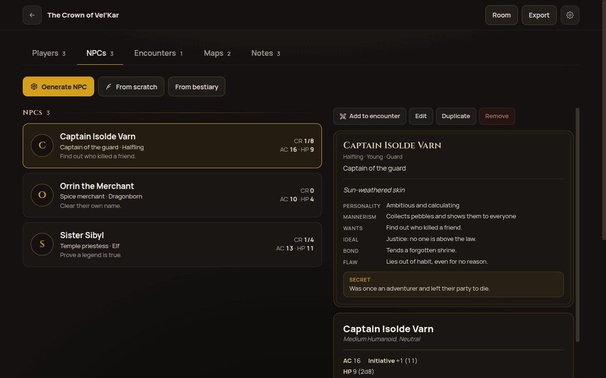

Each NPC has a profile (appearance, personality, ideal, bond, flaw, what they want and a secret)
and a stat block. It is a **copy**: editing the NPC never touches the bestiary.

**Generate NPC** builds a ready NPC in one tap:

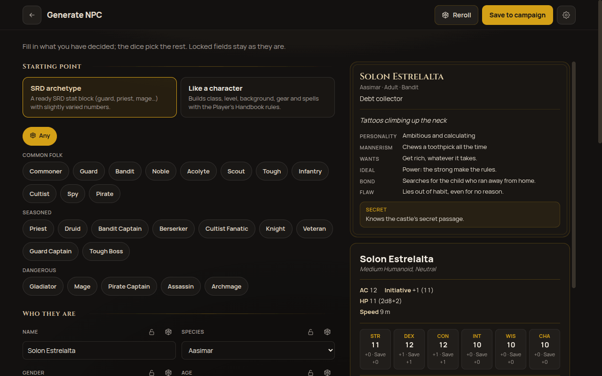

- **SRD archetype**: guard, priest, bandit, mage… with the SRD stat block and slightly varied
  numbers.
- **Like a character**: class, level, background, gear and spells built with the Player's
  Handbook rules; the block comes out with attacks, Extra Attack and summarized spellcasting.
- Fill in what you've decided (say, name *Captain Isolde Varn*, gender, occupation *Captain of the
  guard*); the padlock locks a field and **Reroll** only changes the rest.

### Bestiary

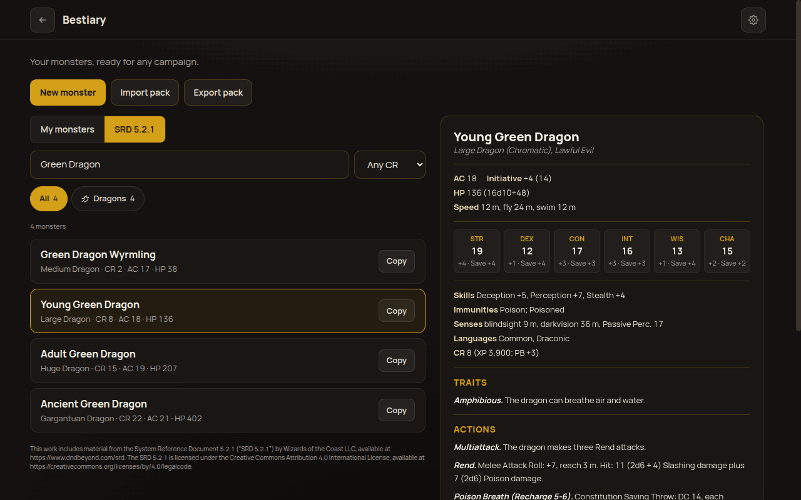

- **SRD 5.2.1**: 330 monsters (EN and PT), grouped by type, with search and CR filter. **Copy**
  brings a monster into yours, editable.
- **My monsters**: the ones from your book, entered in the editor (2024 layout: AC, HP, speeds in
  meters, saves, actions, legendary actions…).
- **Monster pack**: export and import a JSON to share with another GM. Monsters with the same `id`
  are replaced:

```json
{
  "format": "venetia-monsters",
  "version": 1,
  "monsters": [{ "id": "my-ogre-chief", "statblock": { "name": "Ogre Chief", "cr": "3", "...": "..." } }]
}
```

### Encounters and combat

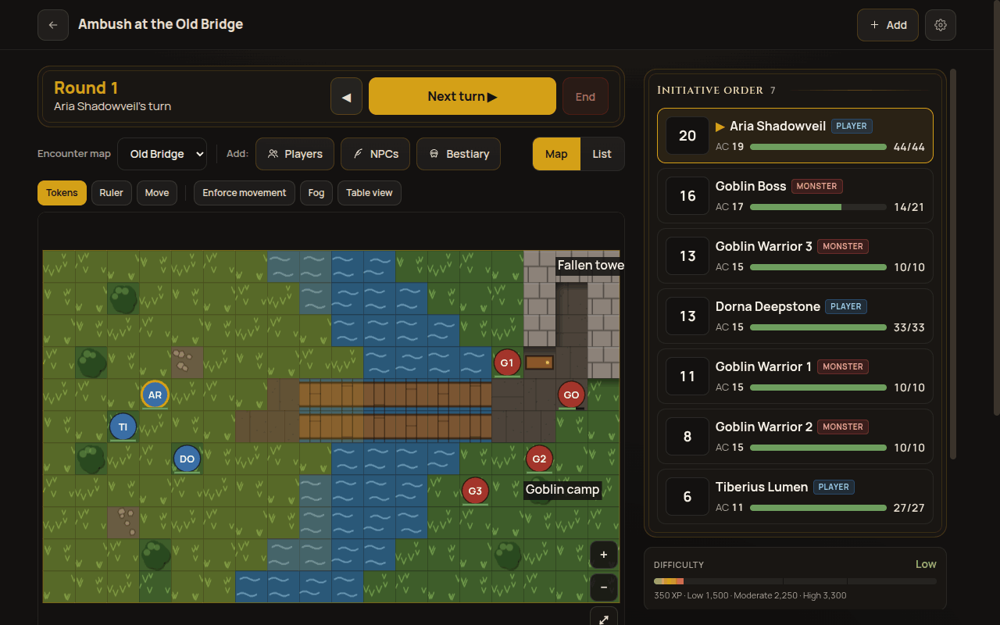

1. **Encounters → New encounter**; add **Players**, **NPCs** or monsters from the **Bestiary**
   (with a count: *3 Goblin Warriors* become Goblin Warrior 1, 2 and 3).
2. **Roll** initiative (everyone, only monsters, or only who's missing) and **Start combat**.
3. **Next turn** advances; the list follows the order and the current turn is highlighted.

In the combatant panel:

| Action | Example |
|---|---|
| damage / healing / temporary HP | `12` damage takes temporary HP first; a monster at 0 HP is defeated, a player is Unconscious |
| concentration | 23 damage to a concentrating caster → CON save **DC 11** (`max(10, half the damage)`, up to 30) |
| conditions | Prone, Restrained, Poisoned, Stunned… (2024 list) |
| roll an action from the block | attack and damage rolled and logged; a crit doubles only the dice |

**Difficulty** compares the monsters' XP with the party's budget.

**On the map:**
- Dragging the token of **whoever has the turn** spends movement along the real path: difficult
  terrain costs 2, walls block, a diagonal counts as 1 square (1.5 m / 5 ft).
- Dragging any other token is a free GM reposition.
- **Enforce movement** refuses impossible moves.
- **Fog** hides areas by hand; **Ruler** measures distances.
- Each combatant can walk, fly or swim.

### Table view

**Table view** turns the screen into just the map, to show the players (a tablet facing the table,
for example). It is exactly what players see in the online room:

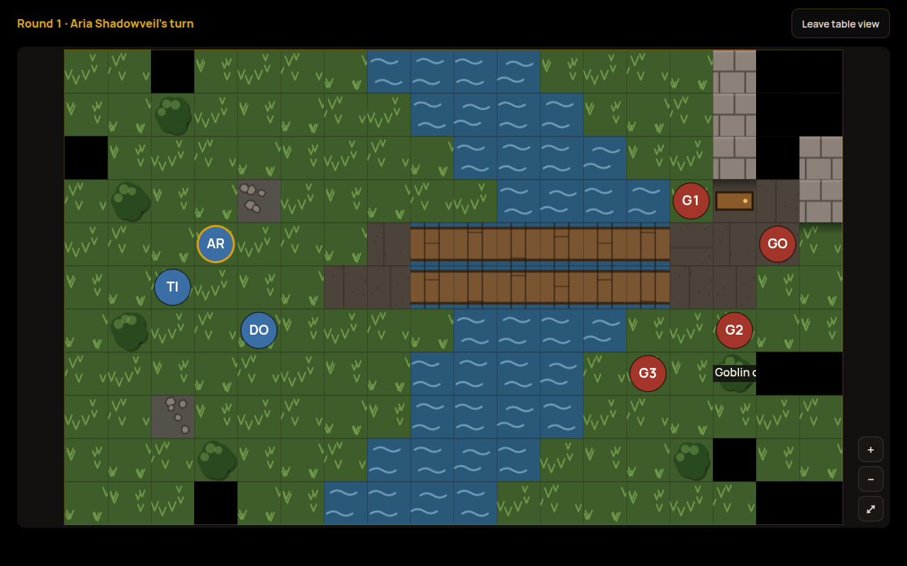

- **In sight**: what the party's tokens see by line of sight. Walls, pillars, trees, boulders and
  void block; doors don't. The GM's fog hides on top.
- **Explored**: what the party has already seen, dimmed and without creatures. It's saved on the
  map and carries over to later battles on it.
- **Never seen**: black.
- **Forget explored** (map tools) resets that memory.

### Grid maps

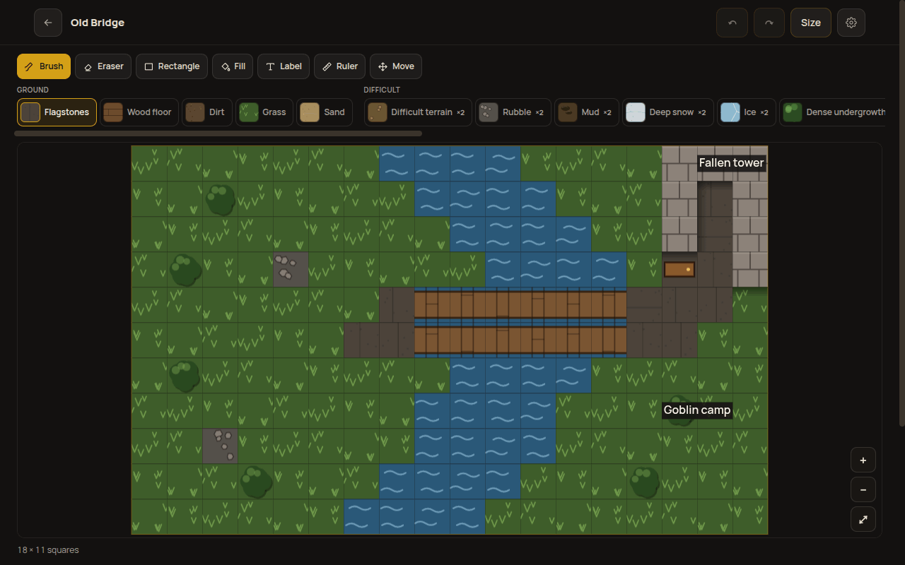

A grid of 1.5 m squares (up to 100×100). Tools: **Brush**, **Eraser**, **Rectangle**, **Fill**
(the connected area), **Label**, **Ruler** and **Move**, with undo and redo. Terrains come in groups
(ground, difficult, water, structure, danger); texture, not color, is what tells them apart.

### Area maps (Beta)

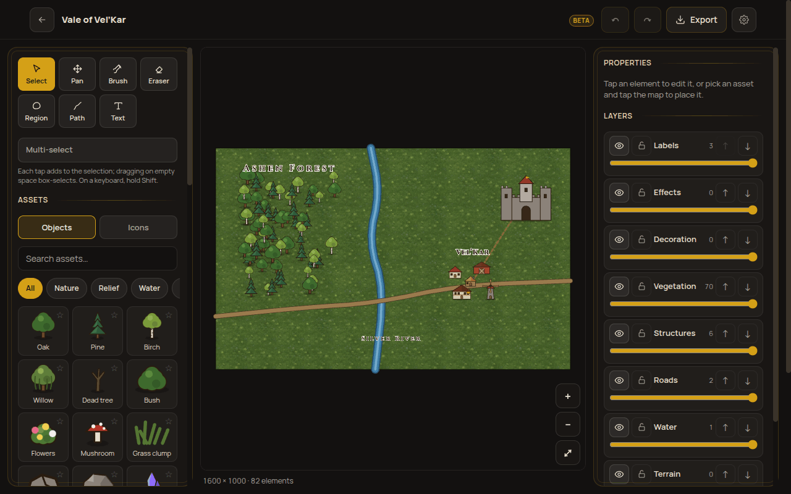

For the region, city or world map, with no combat rules:

- **Brush** with painted textures (grass, forest, sand, snow…) whose edges follow the texture.
- **Objects** (trees, houses, castles, ruins…) and **icons** (city, danger, quest).
- **Paths**: road, trail, river, wall, border.
- **Regions** and **text**, in **layers** (show, lock, opacity).
- **Export** to PNG or JPEG.

### Notes

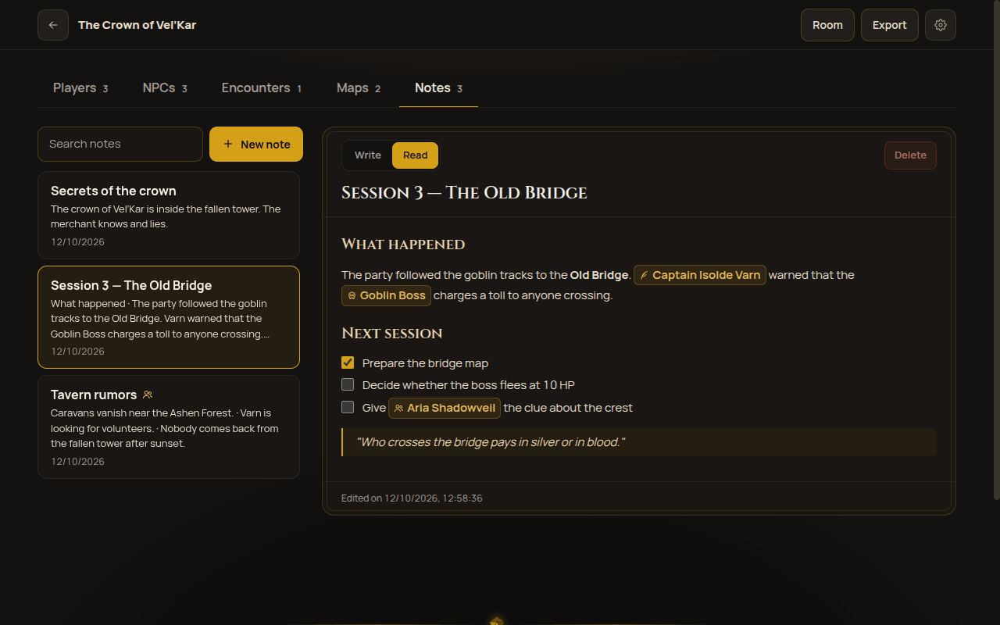

Many notes per campaign, in **markdown**, with search. **Write** edits; **Read** shows it
formatted. In read mode, a task's checkbox really toggles.

| You write | You get |
|---|---|
| `**bold**`, `_italic_`, `~~strike~~` | **bold**, *italic*, ~~strike~~ |
| `## Heading` | a section heading |
| `- item` and `1. item` | lists |
| `- [ ] prepare the map` | a task with a checkbox |
| `> "Who crosses pays in silver."` | a quote |
| `\| A \| B \|` + `\|---\|---\|` | a table |

**Mention with `@`:** type `@` and the start of a name; the toolbar turns into suggestions of
players, NPCs, bestiary and SRD monsters. Pick with the arrows and **Enter** (or tap):

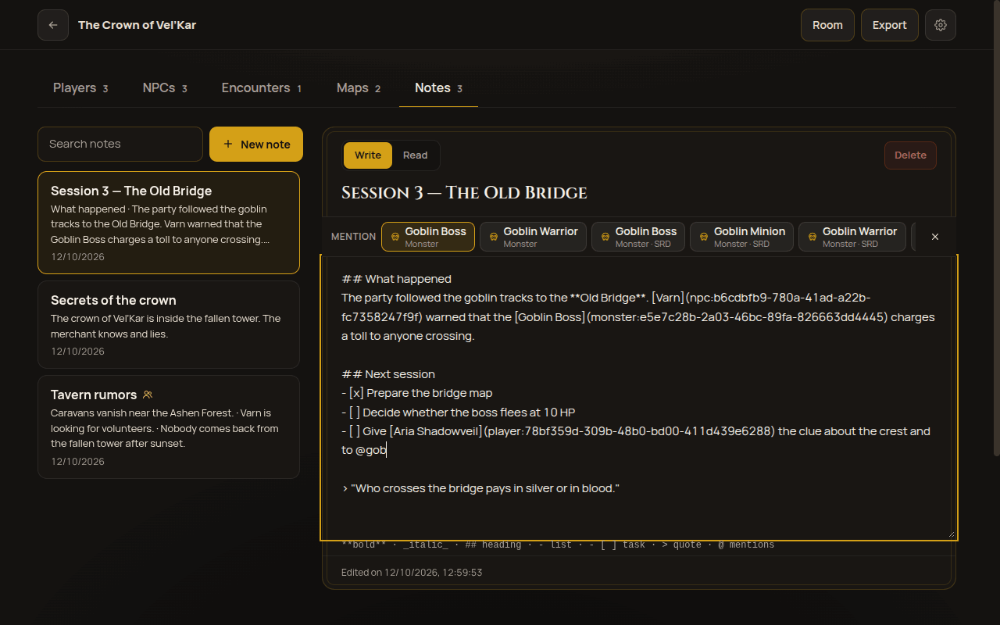

In read mode the mention becomes a chip with the **current name** (renaming the NPC updates the
note). Tapping the chip opens the sheet: the NPC's or monster's block, or the player summary.
Deleted targets show struck through.

---

## 3. Online rooms

The campaign stays on the GM's device; the room only carries what the GM publishes. No accounts:
each device joins with a code and keeps a token. Needs internet.

### Open a room (GM)

1. In the campaign, tap **Room → Open room** (name the table and yourself).
2. Give the players the **6-letter code** (**Copy code** or **Share**).
3. The panel shows who joined and who's online; **Remove** takes a player out, **Close room**
   ends it for everyone.

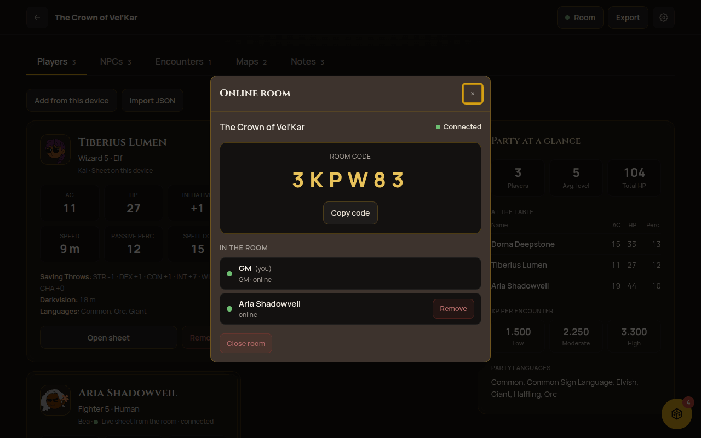

### Join a room (player)

1. **Home → Join a room**.
2. Type the code (`3KP-W83` and `3kpw83` work too), pick your character and your name at the table.
3. The room opens with the **Table**, **Rolls and chat**, **Notes** and **Online room** tabs. Rooms
   you've joined are listed under **Your rooms** on the home screen.

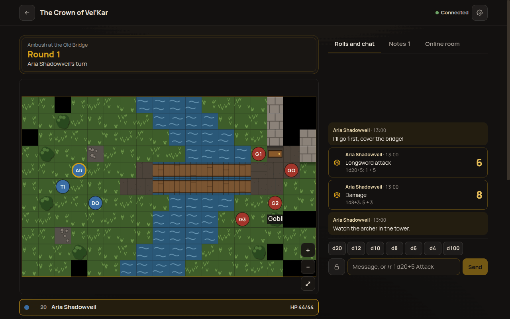

### Live sheets

The sheet of everyone in the room shows up under **Players** as *Live sheet from the room ·
connected*. Every change the player makes (HP, level, spells…) reaches the GM in under a second. If
the player leaves or is removed, the sheet stays as **imported**, with the last version. The GM
never writes into a player's sheet.

### Broadcast the encounter

In the encounter, tap **Broadcast to the table**. From then on every change (movement, turn, HP,
conditions) shows up in the players' **Table** tab, with the [Table view](#table-view) rules. Enemies
only show a health band: *Unhurt, Wounded, Bloodied* (half or less) or *Down*.

### Rolls and chat

Dice are rolled **on the server**: nobody picks the result.

| You type / tap | Result |
|---|---|
| `d20`, `d12`, `d10`, `d8`, `d6`, `d4`, `d100` | rolls one die right away |
| `/r 1d20+5 Longsword attack` | rolls `1d20+5` labeled *Longsword attack* |
| `/r 2d6+1d4+3 Damage` | several dice and a bonus in one roll |
| `/roll 8d6 Fireball` | `/roll` works too |
| `I’ll go first, cover the bridge!` | a chat message |
| padlock on | **player**: only the GM sees · **GM**: only you see |

Limits: up to 100 dice per roll, up to d1000. Away from the room page, the log lives in the
**floating button** (with the count of new entries), on every screen.

### Roll from the sheet

With the sheet in a connected room, dice appear next to ability checks, saving throws, skills,
initiative and attacks (to hit and damage). The result goes to the room log and pops up in a quick
toast:

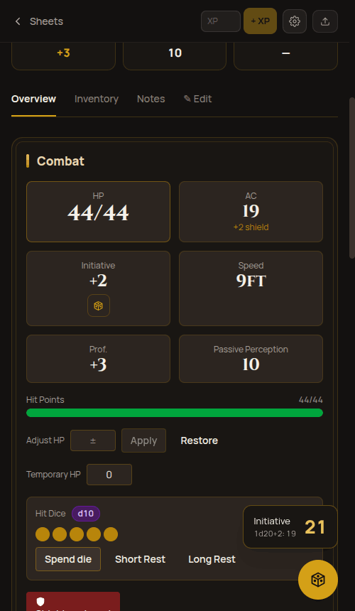

### Shared notes

On a note, **Share with the table** (shown while a room is open) publishes it to the players, who
read it in the **Notes** tab. Mentions of NPCs and monsters show as names only, because players
don't have those sheets. Edits update right away; unsharing or deleting takes it out of the room.

### Who sees what

| | GM | The authoring player | Other players |
|---|---|---|---|
| a player's sheet | ✔ | ✔ | — |
| broadcast table | everything | only what the party sees | only what the party sees |
| public roll | ✔ | ✔ | ✔ |
| player's private roll | ✔ | ✔ | — |
| GM's private roll | ✔ | — | — |
| shared note | ✔ | ✔ | ✔ |
| unshared note | ✔ | — | — |

The server applies these rules before sending anything: what a player can't see never reaches
their device. Closed rooms are deleted after 7 days; unused rooms after 30.
